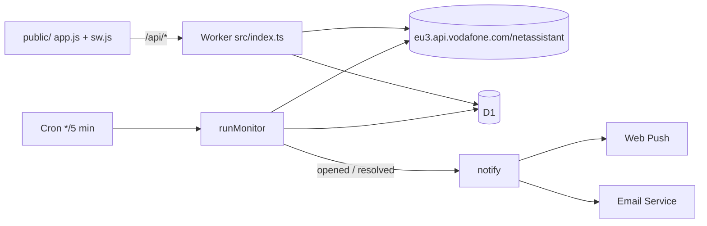

# Vodafone Störungsmelder

Checks the [Vodafone Störungsauskunft](https://www.vodafone.de/stoerung/validate) for an address, records outage history for statistics, and notifies subscribers via Web Push (VAPID) or email.

Runs at <https://vodafone.jonas-strassel.de> on Cloudflare Workers: static assets + Hono API, D1, Cron Triggers, Email Service, Rate Limiting.



## How it works

- **Upstream** (`src/vodafone.ts`): the same API the vodafone.de SPA uses. `suggest` resolves place → street → house number to a Vodafone `addressId`. `faultinfo` is queried by postal code (DSL/mobile) and by `addressId` (cable), and the results are merged. Mobile incidents get the same filter the SPA applies. Requests go over a raw `cloudflare:sockets` TLS connection instead of `fetch()`, because Workers add a `CF-Visitor` header to every outbound fetch and Vodafone rejects requests that carry it. The API key is the public one shipped in the vodafone.de bundle; if Vodafone rotates it, update `VODAFONE_API_KEY` in `wrangler.jsonc`.
- **Monitoring** (`src/monitor.ts`): every 5 minutes, the cron checks each address that was viewed in the last 30 days or has a confirmed subscription. Opening an address page also triggers a live check if the stored result is older than 2 minutes. Each `faultId` appearance is one episode in `faults`. A fault must be absent for 9 minutes before it counts as resolved, which absorbs flapping upstream results. Its end time is when it first went missing.
- **Notifications** (`src/notify.ts`): sent when a fault opens or resolves. Push subscriptions are active immediately. Email needs double opt-in. Emails carry RFC 8058 one-click `List-Unsubscribe`. Push endpoints that return 404/410 are deleted.
- **Web Push** (`src/webpush.ts`): VAPID JWT (ES256) and `aes128gcm` payload encryption, both on WebCrypto, with no dependencies. Only known browser push services are accepted as endpoints.
- **Statistics** (`src/stats.ts`), each over 7/30/90/365 days: availability (time without an incident, overlaps merged), count, total and mean time to resolve, longest incident, and maintenance time. Also: minutes per day for the last 90 days, start times by hour and weekday (Europe/Berlin), and a breakdown by category. Windows are clamped to the period during which the address was actually observed.

## Privacy

No accounts, cookies or analytics. D1 stores the looked-up addresses (with no link to who looked them up) and their fault history. Subscribing adds the email address or the browser's push endpoint; unsubscribing deletes it, and unconfirmed email addresses are deleted after 7 days. The browser keeps the last address and its push tokens in `localStorage`. Rate limiting counts per client IP without persisting it. Cloudflare's Workers Logs (`observability` in `wrangler.jsonc`) keep request metadata for Cloudflare's retention period.

## Setup

Requires the Workers Paid plan (Email Service sending) and `vodafone.jonas-strassel.de` onboarded to Email Service as a sending domain.

```sh
npm install
npx wrangler d1 create vodafone-stoerungen --binding DB --update-config   # writes database_id into wrangler.jsonc
npm run vapid                                                             # prints a VAPID key pair
npx wrangler secret put VAPID_PUBLIC_KEY
npx wrangler secret put VAPID_PRIVATE_KEY
npm run deploy                                                            # applies D1 migrations, then deploys
```

Do not change the VAPID keys once users have subscribed; existing push subscriptions are bound to the public key.

## Development

```sh
npm run vapid > .dev.vars
npm run db:migrate
npm run dev        # http://localhost:8787, emails are written to .wrangler/tmp/email
curl "http://localhost:8787/cdn-cgi/handler/scheduled?cron=*/5+*+*+*+*"   # run the monitor (needs `wrangler dev --test-scheduled`)
npm test
npm run typecheck
```

After changing `wrangler.jsonc`, run `npm run cf-typegen`.

## License

[MIT](LICENSE)
